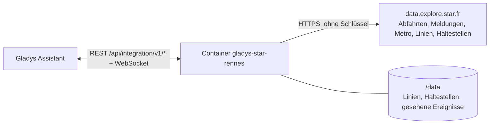
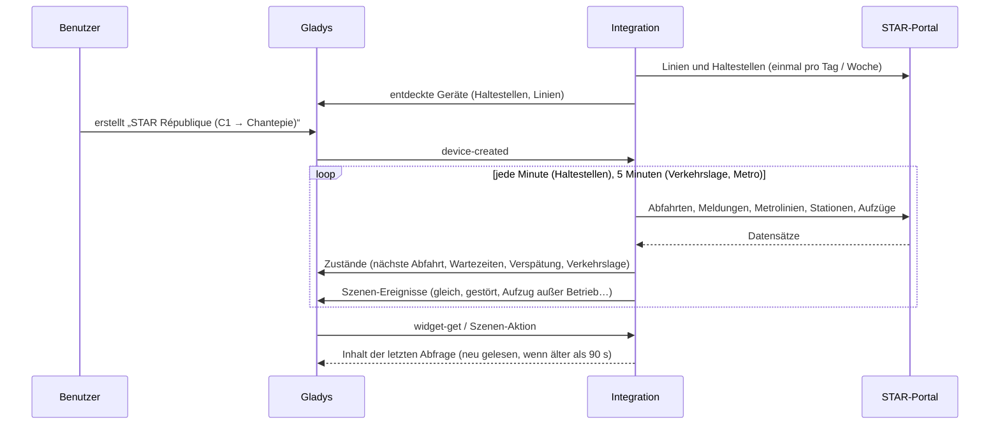
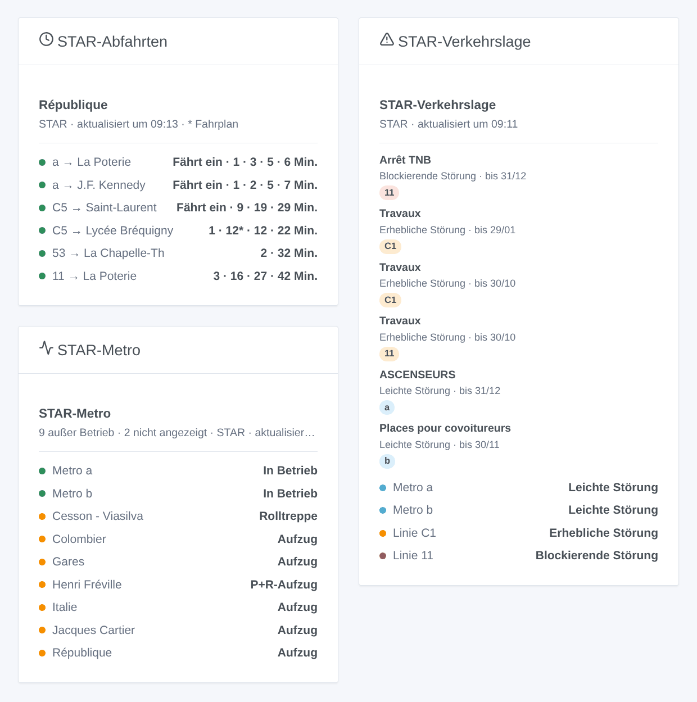

# Gladys STAR Rennes

[English](README.md) · [Français](README.fr.md) · **Deutsch** · [Español](README.es.md)

[](LICENSE)
[](https://github.com/William-De71/gladys-star-rennes/releases)
[](https://github.com/William-De71/gladys-star-rennes/actions/workflows/release.yml)
[](https://gladysassistant.com)


Externe [Gladys Assistant](https://gladysassistant.com)-Integration für **STAR**, das Bus- und Metronetz von Rennes: die nächsten Abfahrten in Echtzeit an deinen Haltestellen, die Verspätung des nächsten Busses, die Verkehrslage deiner Linien und die Aufzüge der Metro, mit Szenen und Dashboard-Widgets. Sie liest das offizielle Open-Data-Portal von STAR, ohne Konto und ohne Schlüssel.

Benutzerdokumentation: [English](docs/en.md) · [Français](docs/fr.md) · [Deutsch](docs/de.md) · [Español](docs/es.md).

> Community-Integration, weder mit STAR, Keolis Rennes noch Rennes Métropole verbunden oder von ihnen unterstützt.

## Funktionen

- **Ein Gerät pro verfolgter Haltestelle** (drei im Formular, bis zu 20 weitere mit der Schaltfläche **Haltestelle hinzufügen**), per Name — alle Straßenseiten und die Metrostation — oder per Kennung — eine Seite — eingegeben und nach **Linie** und **Richtung** gefiltert: nächste Abfahrt, Wartezeit der nächsten zwei Abfahrten, Verspätung des nächsten Busses.
- **Ein Gerät pro verfolgter Linie**, Bus oder Metro (bis zu sechs): ihre Verkehrslage (normal, leichte, erhebliche oder blockierende Störung, Metro gestört) und die aktuellen Störungen.
- **6 Szenen-Auslöser**, **2 Szenen-Aktionen** und **3 Dashboard-Widgets** (siehe unten), einschließlich der Aufzüge und Rolltreppen der Metrostationen.
- Haltestellen standardmäßig jede Minute gelesen (30 s bis 5 min, nachts alle 10 min, wenn nichts angekündigt ist, gestreckt, um im Tageskontingent des Portals zu bleiben), Verkehrslage und Metro alle 5 Minuten; Linien und Haltestellen des Netzes in `/data` gespeichert.
- Konfigurationsschaltflächen: Verbindung testen, Haltestelle suchen (genaue Namen, Kennungen, Linien und Ziele jeder Straßenseite), Haltestellen hinzufügen / entfernen / auflisten, Diagnose.
- Vier Sprachen überall: Englisch, Französisch, Deutsch, Spanisch.

## Funktionsweise




Beim Start liest die Integration die Bus- und Metrolinien sowie die Bushaltestellen und Metro-Bahnsteige des Netzes (Explore API v2.1 des Opendatasoft-Portals) und löst auf, was du eingegeben hast: „C1“ ist die Linie 0001, „a“ die Metrolinie 1001, „République“ alle Bushaltestellen und Metro-Bahnsteige dieses Namens, „1242“ eine davon. Danach liest sie die Abfahrten jeder Haltestelle in ihrem eigenen Takt — die Bus- und Metro-Datensätze, im Portal nach Haltestelle und Linie gefiltert — und behält die der gewählten Richtung; alle 5 Minuten liest sie die Verkehrsmeldungen, den Zustand der Metrolinien und -stationen sowie die Aufzüge und Rolltreppen außer Betrieb. Jede Abfrage wird mit der vorherigen verglichen, um die Szenen-Auslöser auszulösen.



### Transport

Nur Cloud (`"transports": ["cloud"]`): Der Katalog zeigt das Cloud-Abzeichen. Die Integration kontaktiert `data.explore.star.fr`; abgefragt werden nur die verfolgten Haltestellen und Linien. Es gibt keinen lokalen Weg, daher keine Schaltfläche „Lokale Verbindung bevorzugen“.

## Geräte und Funktionen

| Gerät                   | Funktion                           | Kategorie / Typ              | Werte                                          |
| ----------------------- | ---------------------------------- | ---------------------------- | ---------------------------------------------- |
| STAR \<Haltestelle\>    | Nächste Abfahrt                    | `text` / `text`              | „C1 → Chantepie · 6 Min. (+1 Min. Verspätung)“ |
| STAR \<Haltestelle\>    | Wartezeit, Wartezeit der folgenden | `duration` / `integer`       | 0 … 180 min                                    |
| STAR \<Haltestelle\>    | Verspätung der nächsten            | `duration` / `integer`       | 0 … 120 min                                    |
| STAR Linie / Metro \<\> | Verkehrslage                       | `text` / `text`              | „Erhebliche Störung: Travaux“                  |
| STAR Linie / Metro \<\> | Aktuelle Störungen                 | `counter-sensor` / `integer` | 0 … 20                                         |

Ist ein Bus noch nicht geortet, liefert STAR seine Fahrplanzeit: Die Texte sagen „Fahrplanzeit“, das Widget zeigt sie in Grau, und die Verspätung bleibt 0. Nachts, ohne jede Abfahrt, behalten die Wartezeiten ihren letzten Wert (eine 0 würde einen Bus sofort ankündigen).

## Szenen-Auslöser, Aktionen und Widgets



**Szenen-Auslöser** (einmal pro Übergang; die erste Abfrage dient als Referenz und löst nichts aus):

- **Bus oder Metro gleich**: Eine Abfahrt an einer verfolgten Haltestelle erfolgt in 2, 3, 5, 10, 15 oder 20 Minuten. Filter: Haltestelle, Minuten.
- **Linie gestört**: Eine verfolgte Linie erhält eine aktuelle erhebliche oder blockierende Meldung, oder ihre Metro fällt aus. Filter: Linie, Schwere.
- **Linie wieder normal**: Sie fährt wieder normal. Filter: Linie.
- **Neue Verkehrsmeldung**: STAR veröffentlicht eine Meldung zu einer verfolgten Linie. Filter: Linie, Art (geplant, leicht, erheblich, blockierend).
- **Metro-Aufzug außer Betrieb** / **wieder in Betrieb**: ein Aufzug oder eine Rolltreppe einer Metrostation oder der Aufzug ihres P+R-Parkplatzes. Filter: Station, Art. Das ganze Netz: Es muss keine Linie verfolgt werden.

**Szenen-Aktionen**: **nächste Abfahrten** einer Haltestelle (Linie, Ziel, Wartezeit, Uhrzeit, Verspätung, die folgende, ein Satz) und **Verkehrslage einer Linie** (Zustand, Störungen, erste Meldung, ein Satz).

**Widgets**: **STAR-Abfahrten** (eine verfolgte Haltestelle, mehrere in einer Liste oder eine beliebige, in den Einstellungen eingegebene), **STAR-Verkehrslage** (die verfolgten Linien oder die eingegebenen) und **STAR-Metro** (Linien a und b, geschlossene Stationen, Aufzüge und Rolltreppen außer Betrieb).

Beispiele:

- Wenn **die C1 Richtung Chantepie in 5 Minuten an République abfährt** → die Lampe im Flur grün einschalten.
- Wenn **der Aufzug deiner Metrostation ausfällt** → `{{triggerEvent.data.summary}}` an dein Handy senden.
- Jeden Werktag um 7:30 Uhr → **die nächsten Abfahrten** deiner Haltestelle lesen und die `summary` vom Lautsprecher in der Küche ansagen lassen.

## Voraussetzungen

- Gladys Assistant **5.3.0** oder neuer (Widgets und Szenen-Auslöser externer Integrationen, Katalog-Schlagwörter und -Länder von Gladys 5.3). Ältere Instanzen können die Integration nicht installieren.
- Sonst nichts: Das Open-Data-Portal von STAR braucht weder Konto noch Schlüssel.

## Installation

- **Aus dem Store** von Gladys (Integrationen → Externe Integrationen), mit einem Klick, sobald indexiert.
- **Über die Repository-URL**: `https://github.com/William-De71/gladys-star-rennes`.
- **Entwicklermodus**: Baue das Image lokal (`docker build -t gladys-star-rennes .`) und installiere es aus Gladys.

## Konfiguration

| Feld                     | Beschreibung                                                                                             |
| ------------------------ | -------------------------------------------------------------------------------------------------------- |
| Haltestelle (1 bis 3)    | Ein Name („République“) für alle Straßenseiten und die Metro, oder eine Kennung („1242“) für eine Seite. |
| Linie                    | „C1“, „11“, „a“ oder „b“ für die Metro. Leer: alle Linien der Haltestelle.                               |
| Richtung                 | Wörter des Ziels: „Chantepie“, „Poterie \| Gaîté“. Leer: beide.                                          |
| Verfolgte Linien         | Bis zu sechs, durch Kommas getrennt: „a, b, C1, 11“.                                                     |
| Abfrage der Haltestellen | 30 s, 1 min (Standard), 2 min oder 5 min.                                                                |
| Sprache der Texte        | Gerätenamen, Szenen-Zusammenfassungen und -Ausgaben.                                                     |

Schaltflächen: **Verbindung testen**, **Haltestelle suchen** (genaue Namen, Kennungen, Linien und Ziele jeder Straßenseite und jedes Metro-Bahnsteigs), **Haltestelle hinzufügen**, **Haltestelle entfernen**, **Haltestellen auflisten** (die Haltestellen über die drei des Formulars hinaus, in der Gladys-Konfiguration gespeichert) und **Diagnose** (schreibt Haltestellen, Linien, letzte Abfahrten, Fehler und das verbleibende Kontingent in den Tab Protokolle).

## Verwendung

1. Gib eine bis drei Haltestellen ein — mehr mit **Haltestelle hinzufügen** — (auf Wunsch mit Linie und Richtung) sowie die zu verfolgenden Linien und speichere.
2. Erstelle im Tab **Entdecken** die Geräte „STAR …“.
3. Füge die Widgets **STAR-Abfahrten**, **STAR-Verkehrslage** und **STAR-Metro** zu einem Dashboard hinzu und erstelle Szenen mit den Auslösern oben.

## Entwicklung

```bash
npm install
npm test                       # node --test, nie mit Netzwerkzugriff
npm run lint && npm run format:check
npx github:GladysAssistant/integration-store . --skip-image-check
scripts/build-cover.sh         # cover.jpg aus docs/assets/cover.svg
docs/illustrations/render.sh   # docs/assets/widgets.<lang>.png
node .github/scripts/release.mjs next
```

Lokal liest das SDK `GLADYS_HOST_API_URL`, `GLADYS_INTEGRATION_TOKEN` und `GLADYS_INTEGRATION_SELECTOR`; `STAR_API_URL` lenkt die Integration auf eine andere Datensatz-Basis (ein Mock); `DEBUG=gladys-integration-sdk` zeigt die SDK-Protokolle und prüft jeden Widget-Inhalt. Die Tests nutzen echte, gekürzte Antworten des STAR-Portals (`test/fixtures/`, ODbL). Die Regeln des Projekts stehen in [CLAUDE.md](CLAUDE.md).

## Release-Prozess


Jeder Merge auf `main` startet die CI und berechnet dann die Version aus den [Conventional Commits](https://www.conventionalcommits.org/) seit dem letzten Tag: `feat` → Minor, `fix` / `perf` → Patch, `!` oder `BREAKING CHANGE` → Major (ein Minor vor 1.0.0); `docs`, `chore`, `ci`, `test`, `style`, `refactor`, `build` allein veröffentlichen nichts. Der Changelog-Abschnitt wird erzeugt, der Tag gepusht, das Multi-Architektur-Image gebaut, dann erhält `main` den Release-Commit, das GitHub Release wird erstellt und ein letzter Job prüft das öffentliche Image, den Store-Validator und das Topic.

- Der Titel des Pull Requests wird zum Squash-Commit und dann zur Changelog-Zeile: Schreibe ihn auf Englisch, für den Benutzer (`pr-title.yml` prüft ihn). Bearbeite `CHANGELOG.md` nie von Hand.
- 1.0.0 ist eine Entscheidung: Actions → Release → Run workflow mit `release-as: 1.0.0`. `dry-run` zeigt Version und Notizen, ohne zu veröffentlichen.
- **Geschützter Branch**: Das Release pusht seinen Commit mit `GITHUB_TOKEN` auf `main`. Ist ein Ruleset auf `main` strenger als „kein Löschen, kein Force-Push“, füge GitHub Actions seiner Bypass-Liste hinzu (oder pushe über eine GitHub App), sonst schlägt der Veröffentlichungsjob mit Anweisungen fehl.
- Mache nach dem ersten Release das Paket `ghcr.io` öffentlich (Package settings → Change visibility), sonst kann Gladys es nicht laden.

## Fehlerbehebung

Siehe [docs/de.md](docs/de.md#fehlerbehebung). Melde Probleme mit den Versionen von Gladys und der Integration, der betroffenen Haltestelle oder Linie und den Zeilen der Schaltfläche **Diagnose**.

## Mitwirken

Issues und Pull Requests sind willkommen. Führe `npm run format:check && npm run lint && npm test` aus, bevor du einen Pull Request öffnest, und lass alle externen Kennungen und gespeicherten Schlüssel unverändert (siehe [CLAUDE.md](CLAUDE.md)).

## Sicherheit

Siehe [SECURITY.md](SECURITY.md): Melde Schwachstellen vertraulich. Die Integration braucht kein Geheimnis: Sie liest nur öffentliche Open Data und läuft schreibgeschützt, ohne Root-Rechte, in ihrem Container.

## Kommende Screenshots

Die Bilder oben sind Illustrationen, keine Screenshots. Echte Screenshots kommen nach `docs/assets/screenshots/` (PNG, 1280 × 800): `configuration.png`, `discovery.png`, `device.png`, `scene.png`.

## Lizenz

[Apache License 2.0](LICENSE) — siehe auch [NOTICE](NOTICE). Abfahrten, Linien, Haltestellen, Verkehrsmeldungen und der Zustand der Metro sind Open Data von STAR (Keolis Rennes, Rennes Métropole) unter der [ODbL](https://opendatacommons.org/licenses/odbl/1-0/): Die Widgets zeigen die Quelle und die Uhrzeit jeder Abfrage. Danke an die Dokumentation und das SDK von Gladys sowie an STAR und Rennes Métropole für eines der vollständigsten Open-Data-Portale für den Nahverkehr in Frankreich.
