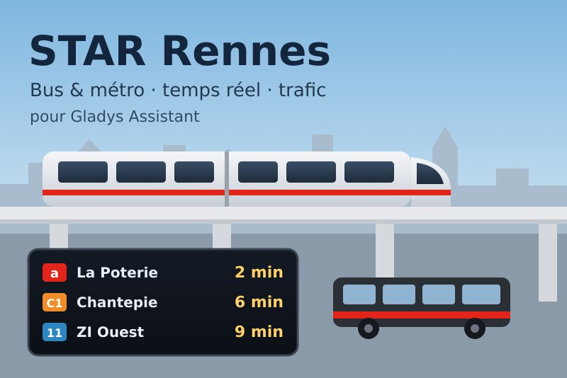
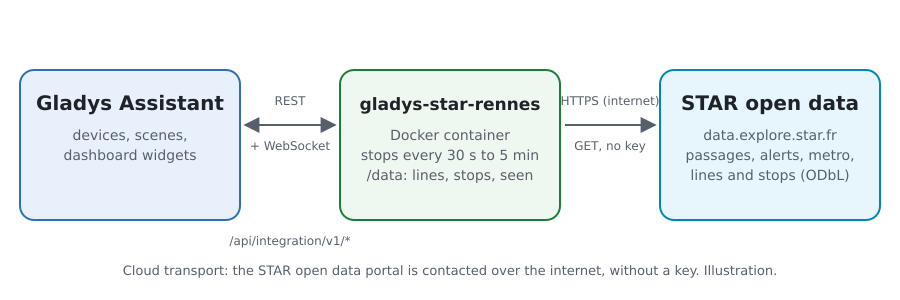
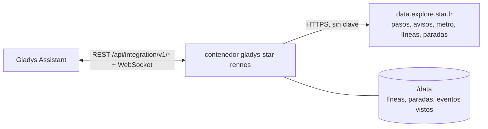
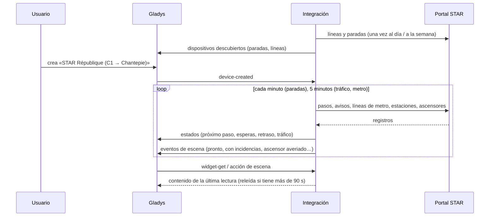
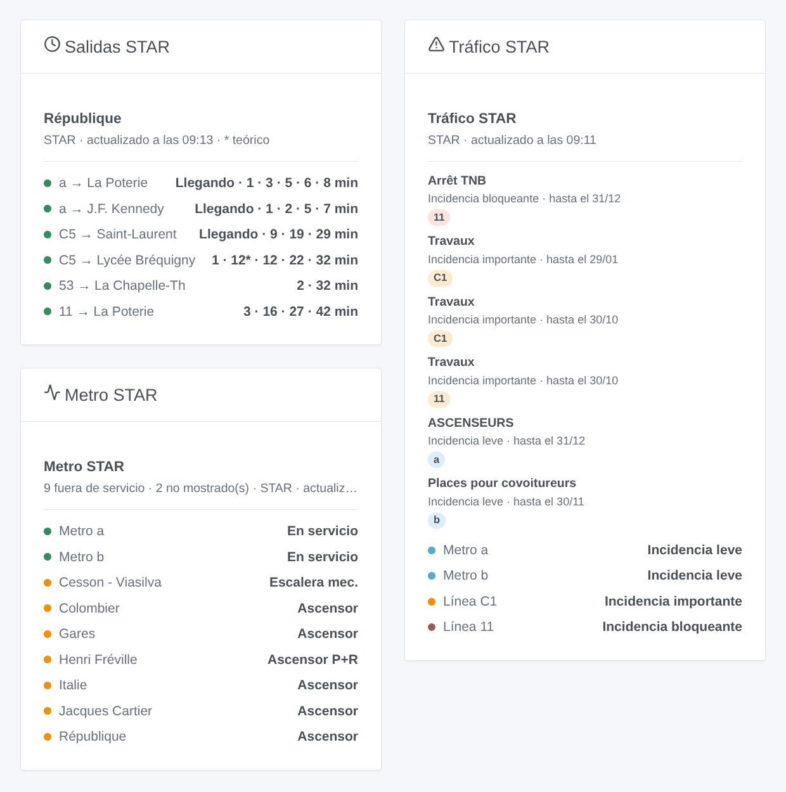

# Gladys STAR Rennes

[English](README.md) · [Français](README.fr.md) · [Deutsch](README.de.md) · **Español**

[](LICENSE)
[](https://github.com/William-De71/gladys-star-rennes/releases)
[](https://github.com/William-De71/gladys-star-rennes/actions/workflows/release.yml)
[](https://gladysassistant.com)



Integración externa de [Gladys Assistant](https://gladysassistant.com) para el **STAR**, la red de autobuses y metro de Rennes: los próximos pasos en tiempo real en tus paradas, el retraso del próximo autobús, el tráfico de tus líneas y los ascensores del metro, con escenas y widgets del panel. Lee el portal oficial de datos abiertos del STAR, sin cuenta ni clave.

Documentación de usuario: [English](docs/en.md) · [Français](docs/fr.md) · [Deutsch](docs/de.md) · [Español](docs/es.md).

> Integración comunitaria, sin afiliación ni respaldo del STAR, Keolis Rennes o Rennes Métropole.

## Funciones

- **Un dispositivo por parada seguida** (tres en el formulario, hasta 20 más con el botón **Añadir una parada**), escrita por su nombre — todos los lados de la calle y la estación de metro — o por su identificador — un solo lado — y filtrada por **línea** y **dirección**: próximo paso, espera de los dos próximos pasos, retraso del próximo autobús.
- **Un dispositivo por línea seguida**, de autobús o de metro (hasta seis): su tráfico (normal, incidencia leve, importante o bloqueante, metro averiado) y las incidencias en curso.
- **6 disparadores de escena**, **2 acciones de escena** y **3 widgets del panel** (abajo), incluidos los ascensores y escaleras mecánicas de las estaciones de metro.
- Paradas leídas cada minuto por defecto (de 30 s a 5 min, cada 10 min de noche cuando no se anuncia nada, espaciadas para no salir de la cuota diaria del portal), tráfico y metro cada 5 minutos; líneas y paradas de la red guardadas en `/data`.
- Botones de configuración: probar la conexión, buscar una parada (nombres exactos, identificadores, líneas y destinos de cada lado de la calle), añadir / quitar / listar paradas, diagnóstico.
- Cuatro idiomas en todas partes: inglés, francés, alemán, español.

## Funcionamiento





Al arrancar, la integración lee las líneas de autobús y de metro y las paradas de autobús y andenes de metro de la red (Explore API v2.1 del portal Opendatasoft), y resuelve lo que has escrito: «C1» es la línea 0001, «a» la línea de metro 1001, «République» todas las paradas de autobús y andenes de metro con ese nombre, «1242» una de ellas. Después lee los pasos de cada parada a su propio ritmo — los conjuntos de datos de autobús y metro, filtrados en el portal por parada y línea — y se queda con los de la dirección elegida; cada 5 minutos lee los avisos de tráfico, el estado de las líneas y estaciones de metro y los ascensores y escaleras mecánicas fuera de servicio. Cada lectura se compara con la anterior para lanzar los disparadores de escena.



### Transporte

Solo cloud (`"transports": ["cloud"]`): el catálogo muestra la insignia cloud. La integración contacta con `data.explore.star.fr`; solo se piden las paradas y líneas seguidas. No hay vía local, así que no hay botón «Preferir la conexión local».

## Dispositivos y funciones

| Dispositivo             | Función                      | Categoría / tipo             | Valores                                      |
| ----------------------- | ---------------------------- | ---------------------------- | -------------------------------------------- |
| STAR \<parada\>         | Próximo paso                 | `text` / `text`              | «C1 → Chantepie · 6 min (+1 min de retraso)» |
| STAR \<parada\>         | Espera, espera del siguiente | `duration` / `integer`       | 0 … 180 min                                  |
| STAR \<parada\>         | Retraso del próximo          | `duration` / `integer`       | 0 … 120 min                                  |
| STAR línea / metro \<\> | Tráfico                      | `text` / `text`              | «Incidencia importante: Travaux»             |
| STAR línea / metro \<\> | Incidencias en curso         | `counter-sensor` / `integer` | 0 … 20                                       |

Cuando un autobús aún no está localizado, el STAR da su horario teórico: los textos indican «horario teórico», el widget lo muestra en gris y el retraso se queda en 0. De noche, sin ningún paso, las esperas conservan su último valor (un 0 anunciaría un autobús ya).

## Disparadores, acciones de escena y widgets



**Disparadores de escena** (una vez por transición; la primera lectura sirve de referencia y no dispara nada):

- **Autobús o metro pronto**: un paso en una parada seguida sale dentro de 2, 3, 5, 10, 15 o 20 minutos. Filtros: parada, minutos.
- **Línea con incidencias**: una línea seguida recibe un aviso importante o bloqueante en curso, o su metro se avería. Filtros: línea, gravedad.
- **Línea vuelve a la normalidad**: vuelve a circular con normalidad. Filtro: línea.
- **Nuevo aviso de tráfico**: el STAR publica un aviso sobre una línea seguida. Filtros: línea, tipo (prevista, leve, importante, bloqueante).
- **Ascensor del metro averiado** / **reparado**: un ascensor o una escalera mecánica de una estación de metro, o el ascensor de su aparcamiento disuasorio. Filtros: estación, tipo. Toda la red: no hace falta seguir ninguna línea.

**Acciones de escena**: **próximos pasos** de una parada (línea, destino, espera, hora, retraso, el siguiente, una frase) y **tráfico de una línea** (estado, incidencias, primer aviso, una frase).

**Widgets**: **Salidas STAR** (una parada seguida, varias en una lista, o cualquier parada escrita en los ajustes), **Tráfico STAR** (las líneas seguidas, o las escritas) y **Metro STAR** (líneas a y b, estaciones cerradas, ascensores y escaleras mecánicas fuera de servicio).

Ejemplos:

- Cuando **el C1 hacia Chantepie sale de République dentro de 5 minutos** → encender en verde la lámpara de la entrada.
- Cuando **el ascensor de tu estación de metro se avería** → enviar `{{triggerEvent.data.summary}}` a tu teléfono.
- Cada día laborable a las 7:30 → **leer los próximos pasos** de tu parada y hacer que el altavoz de la cocina anuncie el `summary`.

## Requisitos

- Gladys Assistant **5.3.0** o posterior (widgets y disparadores de escena de las integraciones externas, palabras clave y países del catálogo de Gladys 5.3). Las instancias anteriores no pueden instalar la integración.
- Nada más: el portal de datos abiertos del STAR no necesita ni cuenta ni clave.

## Instalación

- **Desde la tienda** de Gladys (Integraciones → Integraciones externas), con un clic, una vez indexada.
- **Desde la URL del repositorio**: `https://github.com/William-De71/gladys-star-rennes`.
- **Modo desarrollador**: construye la imagen en local (`docker build -t gladys-star-rennes .`) e instálala desde Gladys.

## Configuración

| Campo                  | Descripción                                                                                                     |
| ---------------------- | --------------------------------------------------------------------------------------------------------------- |
| Parada (1 a 3)         | Un nombre («République») para todos los lados de la calle y el metro, o un identificador («1242») para un lado. |
| Línea                  | «C1», «11», «a» o «b» para el metro. Vacío: todas las líneas de la parada.                                      |
| Dirección              | Palabras del destino: «Chantepie», «Poterie \| Gaîté». Vacío: ambos sentidos.                                   |
| Líneas seguidas        | Hasta seis, separadas por comas: «a, b, C1, 11».                                                                |
| Lectura de las paradas | 30 s, 1 min (por defecto), 2 min o 5 min.                                                                       |
| Idioma de los textos   | Nombres de los dispositivos, resúmenes y salidas de las escenas.                                                |

Botones: **Probar la conexión**, **Buscar una parada** (nombres exactos, identificadores, líneas y destinos de cada lado de la calle y de cada andén de metro), **Añadir una parada**, **Quitar una parada**, **Listar las paradas** (las paradas más allá de las tres del formulario, guardadas en la configuración de Gladys) y **Diagnóstico** (escribe las paradas, líneas, últimos pasos, errores y la cuota restante en la pestaña Registros).

## Uso

1. Escribe de una a tres paradas — más con **Añadir una parada** — (con su línea y dirección si quieres) y las líneas que seguir, y guarda.
2. En la pestaña **Descubrir**, crea los dispositivos «STAR …».
3. Añade los widgets **Salidas STAR**, **Tráfico STAR** y **Metro STAR** a un panel, y crea escenas con los disparadores de arriba.

## Desarrollo

```bash
npm install
npm test                       # node --test, nunca toca la red
npm run lint && npm run format:check
npx github:GladysAssistant/integration-store . --skip-image-check
scripts/build-cover.sh         # cover.jpg desde docs/assets/cover.svg
docs/illustrations/render.sh   # docs/assets/widgets.<lang>.png
node .github/scripts/release.mjs next
```

En local, el SDK lee `GLADYS_HOST_API_URL`, `GLADYS_INTEGRATION_TOKEN` y `GLADYS_INTEGRATION_SELECTOR`; `STAR_API_URL` dirige la integración a otra raíz de conjuntos de datos (un simulador); `DEBUG=gladys-integration-sdk` muestra los registros del SDK y comprueba cada contenido de widget. Las pruebas usan respuestas reales del portal STAR, reducidas (`test/fixtures/`, ODbL). Las reglas del proyecto están en [CLAUDE.md](CLAUDE.md).

## Proceso de publicación


Cada fusión en `main` lanza la CI y luego calcula la versión a partir de los [Conventional Commits](https://www.conventionalcommits.org/) desde la última etiqueta: `feat` → menor, `fix` / `perf` → parche, `!` o `BREAKING CHANGE` → mayor (una menor antes de 1.0.0); `docs`, `chore`, `ci`, `test`, `style`, `refactor`, `build` solos no publican nada. Se genera la sección del changelog, se sube la etiqueta, se construye la imagen multiarquitectura, después `main` recibe el commit de publicación, se crea la GitHub Release y un último job comprueba la imagen pública, el validador de la tienda y el topic.

- El título de la pull request se convierte en el commit squash y luego en la línea del changelog: escríbelo en inglés, para el usuario (`pr-title.yml` lo comprueba). Nunca edites `CHANGELOG.md` a mano.
- La 1.0.0 es una decisión: Actions → Release → Run workflow con `release-as: 1.0.0`. `dry-run` muestra la versión y las notas sin publicar nada.
- **Rama protegida**: la publicación sube su commit a `main` con `GITHUB_TOKEN`. Con un ruleset en `main` más estricto que «sin borrado, sin force-push», añade GitHub Actions a su lista de excepciones (o sube mediante una GitHub App); si no, el job de publicación falla con instrucciones.
- Tras la primera publicación, haz público el paquete `ghcr.io` (Package settings → Change visibility); si no, Gladys no puede descargarlo.

## Solución de problemas

Consulta [docs/es.md](docs/es.md#solución-de-problemas). Informa de los problemas con las versiones de Gladys y de la integración, la parada o línea afectada, y las líneas del botón **Diagnóstico**.

## Contribuir

Issues y pull requests son bienvenidas. Ejecuta `npm run format:check && npm run lint && npm test` antes de abrir una pull request, y no cambies ningún identificador externo ni clave guardada (consulta [CLAUDE.md](CLAUDE.md)).

## Seguridad

Consulta [SECURITY.md](SECURITY.md): informa de las vulnerabilidades en privado. La integración no necesita ningún secreto: solo lee datos abiertos públicos, y se ejecuta en solo lectura, sin privilegios de root, en su contenedor.

## Capturas pendientes

Las imágenes de arriba son ilustraciones, no capturas de pantalla. Las capturas reales irán en `docs/assets/screenshots/` (PNG, 1280 × 800): `configuration.png`, `discovery.png`, `device.png`, `scene.png`.

## Licencia

[Licencia Apache 2.0](LICENSE) — consulta también [NOTICE](NOTICE). Los pasos, líneas, paradas, avisos de tráfico y el estado del metro son datos abiertos del STAR (Keolis Rennes, Rennes Métropole) bajo la [ODbL](https://opendatacommons.org/licenses/odbl/1-0/): los widgets muestran la fuente y la hora de cada lectura. Gracias a la documentación y al SDK de Gladys, y al STAR y a Rennes Métropole por uno de los portales de datos abiertos de transporte más completos de Francia.
