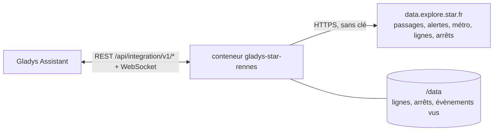
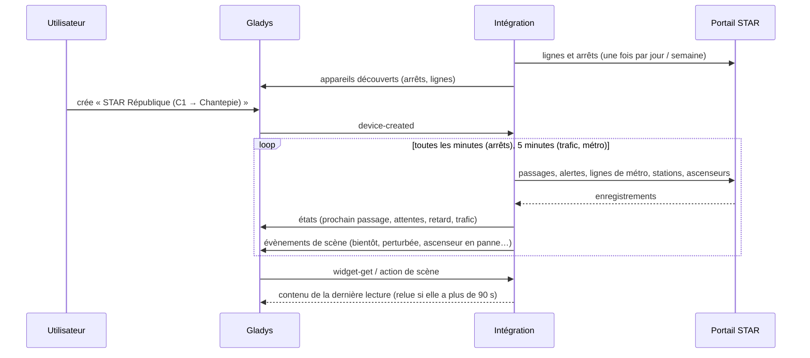
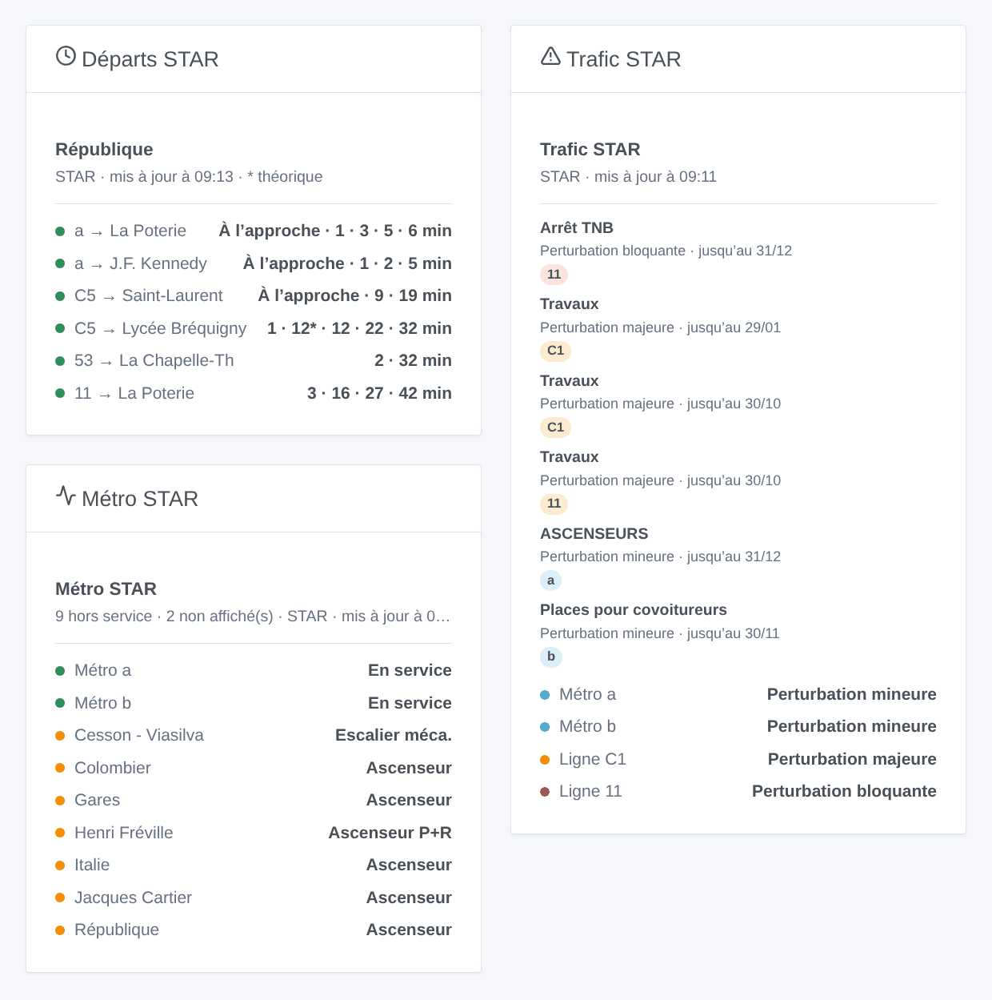

# Gladys STAR Rennes

[English](README.md) · **Français** · [Deutsch](README.de.md) · [Español](README.es.md)

[](LICENSE)
[](https://github.com/William-De71/gladys-star-rennes/releases)
[](https://github.com/William-De71/gladys-star-rennes/actions/workflows/release.yml)
[](https://gladysassistant.com)


Intégration externe [Gladys Assistant](https://gladysassistant.com) pour le **STAR**, le réseau de bus et de métro de Rennes : les prochains passages en temps réel à vos arrêts, le retard du prochain bus, le trafic de vos lignes et les ascenseurs du métro, avec des scènes et des widgets de tableau de bord. Elle lit le portail open data officiel du STAR, sans compte ni clé.

Documentation utilisateur : [English](docs/en.md) · [Français](docs/fr.md) · [Deutsch](docs/de.md) · [Español](docs/es.md).

> Intégration communautaire, ni affiliée ni soutenue par le STAR, Keolis Rennes ou Rennes Métropole.

## Fonctionnalités

- **Un appareil par arrêt suivi** (trois dans le formulaire, jusqu’à 20 de plus avec le bouton **Ajouter un arrêt**), saisi par son nom — tous les côtés de la rue et la station de métro — ou par son identifiant — un seul côté — et filtré par **ligne** et **direction** : prochain passage, attente des deux prochains passages, retard du prochain bus.
- **Un appareil par ligne suivie**, bus ou métro (six au plus) : son trafic (normal, perturbation mineure, majeure ou bloquante, métro en panne) et les perturbations en cours.
- **6 déclencheurs de scène**, **2 actions de scène** et **3 widgets de tableau de bord** (ci-dessous), y compris les ascenseurs et escaliers mécaniques des stations de métro.
- Arrêts lus toutes les minutes par défaut (30 s à 5 min, toutes les 10 min la nuit quand rien n’est annoncé, espacés pour rester dans le quota quotidien du portail), trafic et métro toutes les 5 minutes ; lignes et arrêts du réseau gardés dans `/data`.
- Boutons de configuration : tester la connexion, chercher un arrêt (noms exacts, identifiants, lignes et destinations de chaque côté de la rue), ajouter / retirer / lister les arrêts, diagnostic.
- Quatre langues partout : anglais, français, allemand, espagnol.

## Fonctionnement




Au démarrage, l’intégration lit les lignes de bus et de métro, les arrêts de bus et les quais de métro du réseau (Explore API v2.1 du portail Opendatasoft), et résout ce que vous avez saisi : « C1 » est la ligne 0001, « a » la ligne de métro 1001, « République » tous les arrêts de bus et quais de métro de ce nom, « 1242 » l’un d’eux. Elle lit ensuite les passages de chaque arrêt à son propre rythme — les jeux de données bus et métro, filtrés sur le portail par arrêt et par ligne — et garde ceux de la direction choisie ; toutes les 5 minutes, elle lit les alertes trafic, l’état des lignes et stations de métro et les ascenseurs et escaliers mécaniques hors service. Chaque lecture est comparée à la précédente pour lancer les déclencheurs de scène.



### Transport

Cloud uniquement (`"transports": ["cloud"]`) : le catalogue affiche le badge cloud. L’intégration contacte `data.explore.star.fr` ; seuls les arrêts et lignes suivis sont demandés. Il n’y a pas de voie locale, donc pas de bouton « Préférer la connexion locale ».

## Appareils et fonctionnalités

| Appareil                | Fonctionnalité              | Catégorie / type             | Valeurs                                       |
| ----------------------- | --------------------------- | ---------------------------- | --------------------------------------------- |
| STAR \<arrêt\>          | Prochain passage            | `text` / `text`              | « C1 → Chantepie · 6 min (+1 min de retard) » |
| STAR \<arrêt\>          | Attente, attente du suivant | `duration` / `integer`       | 0 … 180 min                                   |
| STAR \<arrêt\>          | Retard du prochain          | `duration` / `integer`       | 0 … 120 min                                   |
| STAR ligne / métro \<\> | Trafic                      | `text` / `text`              | « Perturbation majeure : Travaux »            |
| STAR ligne / métro \<\> | Perturbations en cours      | `counter-sensor` / `integer` | 0 … 20                                        |

Quand un bus n’est pas encore localisé, le STAR donne son horaire théorique : les textes indiquent « horaire théorique », le widget l’affiche en gris et le retard reste à 0. La nuit, sans aucun passage, les attentes gardent leur dernière valeur (un 0 annoncerait un bus tout de suite).

## Déclencheurs, actions de scène et widgets



**Déclencheurs de scène** (une fois par transition ; la première lecture sert de référence et ne déclenche rien) :

- **Bus ou métro bientôt** : un passage à un arrêt suivi part dans 2, 3, 5, 10, 15 ou 20 minutes. Filtres : arrêt, minutes.
- **Ligne perturbée** : une ligne suivie reçoit une alerte majeure ou bloquante en cours, ou son métro tombe en panne. Filtres : ligne, gravité.
- **Ligne revenue à la normale** : elle circule de nouveau normalement. Filtre : ligne.
- **Nouvelle alerte trafic** : le STAR publie une alerte sur une ligne suivie. Filtres : ligne, type (prévue, mineure, majeure, bloquante).
- **Ascenseur du métro en panne** / **réparé** : un ascenseur ou un escalier mécanique d’une station de métro, ou l’ascenseur de son parc relais. Filtres : station, type. Tout le réseau : aucune ligne n’a besoin d’être suivie.

**Actions de scène** : **prochains passages** d’un arrêt (ligne, destination, attente, heure, retard, le suivant, une phrase) et **trafic d’une ligne** (état, perturbations, première alerte, une phrase).

**Widgets** : **Départs STAR** (un arrêt suivi, plusieurs dans une même liste, ou n’importe quel arrêt saisi dans les réglages), **Trafic STAR** (les lignes suivies, ou celles saisies) et **Métro STAR** (lignes a et b, stations fermées, ascenseurs et escaliers mécaniques hors service).

Exemples :

- Quand **le C1 vers Chantepie part de République dans 5 minutes** → allumer la lampe de l’entrée en vert.
- Quand **l’ascenseur de votre station de métro tombe en panne** → envoyer `{{triggerEvent.data.summary}}` sur votre téléphone.
- Chaque jour de semaine à 7 h 30 → **lire les prochains passages** de votre arrêt et faire annoncer le `summary` par l’enceinte de la cuisine.

## Prérequis

- Gladys Assistant **5.3.0** ou plus récent (widgets et déclencheurs de scène des intégrations externes, mots-clés et pays du catalogue de Gladys 5.3). Les instances plus anciennes ne peuvent pas installer l’intégration.
- Rien d’autre : le portail open data du STAR ne demande ni compte ni clé.

## Installation

- **Depuis le store** de Gladys (Intégrations → Intégrations externes), en un clic, une fois indexée.
- **Depuis l’URL du dépôt** : `https://github.com/William-De71/gladys-star-rennes`.
- **Mode développeur** : construisez l’image en local (`docker build -t gladys-star-rennes .`) et installez-la depuis Gladys.

## Configuration

| Champ              | Description                                                                                                        |
| ------------------ | ------------------------------------------------------------------------------------------------------------------ |
| Arrêt (1 à 3)      | Un nom (« République ») pour tous les côtés de la rue et le métro, ou un identifiant (« 1242 ») pour un seul côté. |
| Ligne              | « C1 », « 11 », « a » ou « b » pour le métro. Vide : toutes les lignes de l’arrêt.                                 |
| Direction          | Mots de la destination : « Chantepie », « Poterie \| Gaîté ». Vide : les deux sens.                                |
| Lignes suivies     | Six au plus, séparées par des virgules : « a, b, C1, 11 ».                                                         |
| Lecture des arrêts | 30 s, 1 min (par défaut), 2 min ou 5 min.                                                                          |
| Langue des textes  | Noms des appareils, résumés et sorties des scènes.                                                                 |

Boutons : **Tester la connexion**, **Chercher un arrêt** (noms exacts, identifiants, lignes et destinations de chaque côté de la rue et de chaque quai de métro), **Ajouter un arrêt**, **Retirer un arrêt**, **Lister les arrêts** (les arrêts au-delà des trois du formulaire, gardés dans la configuration de Gladys) et **Diagnostic** (écrit les arrêts, lignes, derniers passages, erreurs et le quota restant dans l’onglet Journaux).

## Utilisation

1. Saisissez un à trois arrêts — plus avec **Ajouter un arrêt** — (avec leur ligne et leur direction si vous voulez) et les lignes à suivre, puis enregistrez.
2. Dans l’onglet **Découvrir**, créez les appareils « STAR … ».
3. Ajoutez les widgets **Départs STAR**, **Trafic STAR** et **Métro STAR** à un tableau de bord, et créez des scènes avec les déclencheurs ci-dessus.

## Développement

```bash
npm install
npm test                       # node --test, ne touche jamais le réseau
npm run lint && npm run format:check
npx github:GladysAssistant/integration-store . --skip-image-check
scripts/build-cover.sh         # cover.jpg depuis docs/assets/cover.svg
docs/illustrations/render.sh   # docs/assets/widgets.<lang>.png
node .github/scripts/release.mjs next
```

En local, le SDK lit `GLADYS_HOST_API_URL`, `GLADYS_INTEGRATION_TOKEN` et `GLADYS_INTEGRATION_SELECTOR` ; `STAR_API_URL` dirige l’intégration vers une autre racine de jeux de données (un bouchon) ; `DEBUG=gladys-integration-sdk` affiche les journaux du SDK et vérifie chaque contenu de widget. Les tests utilisent de vraies réponses du portail STAR, réduites (`test/fixtures/`, ODbL). Les règles du projet sont dans [CLAUDE.md](CLAUDE.md).

## Processus de release


Chaque fusion sur `main` lance la CI, puis calcule la version depuis les [Conventional Commits](https://www.conventionalcommits.org/) depuis le dernier tag : `feat` → mineure, `fix` / `perf` → correctif, `!` ou `BREAKING CHANGE` → majeure (une mineure avant 1.0.0) ; `docs`, `chore`, `ci`, `test`, `style`, `refactor`, `build` seuls ne publient rien. La section du changelog est générée, le tag poussé, l’image multi-architecture construite, puis `main` reçoit le commit de release, la GitHub Release est créée et un dernier job vérifie l’image publique, le validateur du store et le topic.

- Le titre de la pull request devient le commit squash, puis la ligne du changelog : écrivez-le en anglais, pour l’utilisateur (`pr-title.yml` le vérifie). Ne modifiez jamais `CHANGELOG.md` à la main.
- La 1.0.0 est une décision : Actions → Release → Run workflow avec `release-as: 1.0.0`. `dry-run` affiche la version et les notes sans rien publier.
- **Branche protégée** : la release pousse son commit sur `main` avec `GITHUB_TOKEN`. Avec un ruleset sur `main` plus strict que « ni suppression, ni force-push », ajoutez GitHub Actions à sa liste de contournement (ou poussez via une GitHub App), sinon le job de publication échoue avec des instructions.
- Après la première release, rendez public le package `ghcr.io` (Package settings → Change visibility), sinon Gladys ne peut pas le télécharger.

## Dépannage

Voir [docs/fr.md](docs/fr.md#dépannage). Signalez les problèmes avec les versions de Gladys et de l’intégration, l’arrêt ou la ligne concerné, et les lignes du bouton **Diagnostic**.

## Contribuer

Issues et pull requests bienvenues. Lancez `npm run format:check && npm run lint && npm test` avant d’ouvrir une pull request, et gardez inchangés tous les identifiants externes et clés stockées (voir [CLAUDE.md](CLAUDE.md)).

## Sécurité

Voir [SECURITY.md](SECURITY.md) : signalez les vulnérabilités en privé. L’intégration n’a besoin d’aucun secret : elle lit seulement des données ouvertes publiques, et tourne en lecture seule, sans droits root, dans son conteneur.

## Captures à venir

Les images ci-dessus sont des illustrations, pas des captures d’écran. Les vraies captures iront dans `docs/assets/screenshots/` (PNG, 1280 × 800) : `configuration.png`, `discovery.png`, `device.png`, `scene.png`.

## Licence

[Licence Apache 2.0](LICENSE) — voir aussi [NOTICE](NOTICE). Les passages, lignes, arrêts, alertes trafic et l’état du métro sont des données ouvertes du STAR (Keolis Rennes, Rennes Métropole) sous licence [ODbL](https://opendatacommons.org/licenses/odbl/1-0/) : les widgets affichent la source et l’heure de chaque lecture. Merci à la documentation et au SDK de Gladys, et au STAR et à Rennes Métropole pour l’un des portails open data de transport les plus complets de France.
