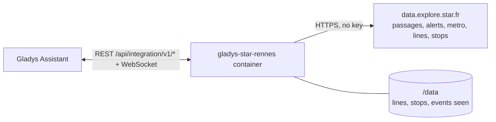
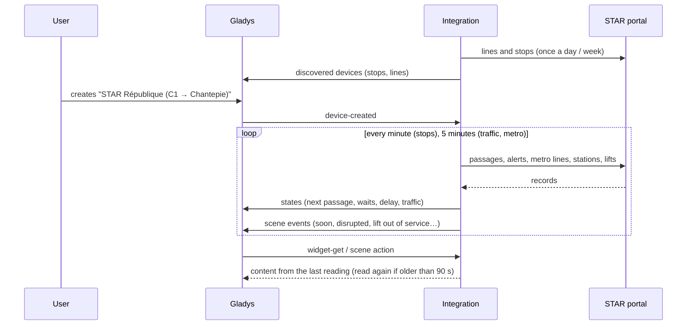
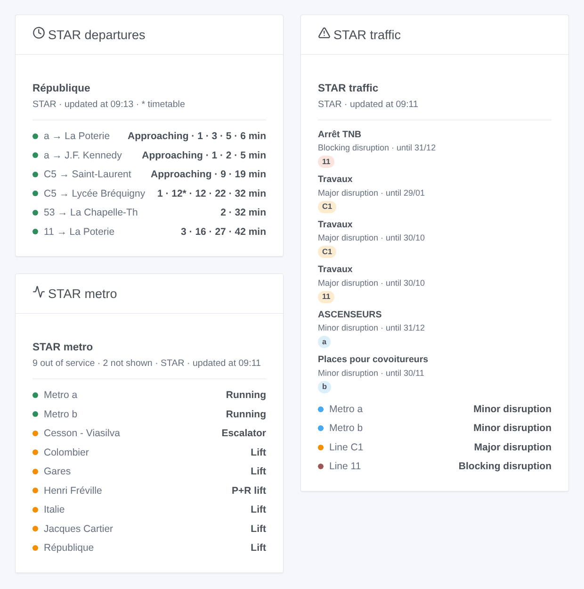

# Gladys STAR Rennes

**English** · [Français](README.fr.md) · [Deutsch](README.de.md) · [Español](README.es.md)

[](LICENSE)
[](https://github.com/William-De71/gladys-star-rennes/releases)
[](https://github.com/William-De71/gladys-star-rennes/actions/workflows/release.yml)
[](https://gladysassistant.com)


[Gladys Assistant](https://gladysassistant.com) external integration for **STAR**, the bus and metro network of Rennes: the next passages in real time at your stops, the delay of the next bus, the traffic of your lines and the lifts of the metro, with scenes and dashboard widgets. It reads the official open data portal of STAR, without an account or a key.

User documentation: [English](docs/en.md) · [Français](docs/fr.md) · [Deutsch](docs/de.md) · [Español](docs/es.md).

> Community integration, not affiliated with nor endorsed by STAR, Keolis Rennes or Rennes Métropole.

## Features

- **One device per followed stop** (three in the form, up to 20 more with the **Add a stop** button), typed by name — every side of the street and the metro station — or by id — one side — and filtered by **line** and **direction**: next passage, wait of the next two passages, delay of the next bus.
- **One device per followed line**, bus or metro (up to six): its traffic (normal, minor, major or blocking disruption, metro down) and the disruptions under way.
- **6 scene triggers**, **2 scene actions** and **3 dashboard widgets** (below), including the lifts and escalators of the metro stations.
- Stops read every minute by default (30 s to 5 min, every 10 min at night when nothing is announced, stretched to stay within the daily quota of the portal), traffic and metro every 5 minutes; lines and stops of the network kept in `/data`.
- Configuration buttons: test the connection, find a stop (exact names, ids, lines and destinations of each side of the street), add / remove / list stops, diagnostic.
- Four languages everywhere: English, French, German, Spanish.

## How it works




At start, the integration reads the bus and metro lines and the bus stops and metro platforms of the network (Explore API v2.1 of the Opendatasoft portal), and resolves what you typed: "C1" is line 0001, "a" the metro line 1001, "République" every bus stop and metro platform of that name, "1242" one of them. Then it reads the passages of each stop on its own timer — the bus and metro datasets, filtered on the portal by stop and line — and keeps the ones of the chosen direction; every 5 minutes it reads the traffic alerts, the state of the metro lines and stations and the lifts and escalators out of service. Each reading is compared with the previous one to fire the scene triggers.



### Transport

Cloud only (`"transports": ["cloud"]`): the catalog shows the cloud badge. The integration contacts `data.explore.star.fr`; only the followed stops and lines are asked. There is no local alternative, so there is no "prefer the local connection" button.

## Devices and features

| Device                 | Feature                      | Category / type              | Values                                 |
| ---------------------- | ---------------------------- | ---------------------------- | -------------------------------------- |
| STAR \<stop\>          | Next passage                 | `text` / `text`              | "C1 → Chantepie · 6 min (+1 min late)" |
| STAR \<stop\>          | Wait, wait for the following | `duration` / `integer`       | 0 … 180 min                            |
| STAR \<stop\>          | Delay of the next one        | `duration` / `integer`       | 0 … 120 min                            |
| STAR line / metro \<\> | Traffic                      | `text` / `text`              | "Major disruption: Travaux"            |
| STAR line / metro \<\> | Disruptions under way        | `counter-sensor` / `integer` | 0 … 20                                 |

When a bus is not located yet, STAR gives its timetable time: the texts say "timetable", the widget shows it in grey, and the delay stays 0. At night, without any passage, the waits keep their last value (a 0 would announce a bus now).

## Scene triggers, actions and widgets



**Scene triggers** (once per transition; the first reading is a reference and fires nothing):

- **Bus or metro soon**: a passage at a followed stop leaves in 2, 3, 5, 10, 15 or 20 minutes. Filters: stop, minutes.
- **Line disrupted**: a followed line gets a major or blocking alert under way, or its metro goes down. Filters: line, severity.
- **Line back to normal**: it runs normally again. Filter: line.
- **New traffic alert**: STAR publishes an alert about a followed line. Filters: line, kind (planned, minor, major, blocking).
- **Metro lift out of service** / **back in service**: a lift or an escalator of a metro station, or the lift of its park-and-ride. Filters: station, kind. The whole network: no line needs to be followed.

**Scene actions**: **next passages** of a stop (line, destination, wait, time, delay, the following one, a sentence) and **traffic of a line** (state, disruptions, first alert, a sentence).

**Widgets**: **STAR departures** (a followed stop, several in one list, or any stop typed in the settings), **STAR traffic** (the followed lines, or the ones typed) and **STAR metro** (lines a and b, closed stations, lifts and escalators out of service).

Examples:

- When **the C1 towards Chantepie leaves République in 5 minutes** → light the hall lamp in green.
- When **the lift of your metro station goes out of service** → send `{{triggerEvent.data.summary}}` to your phone.
- Every weekday at 7:30 → **read the next passages** of your stop and have the `summary` spoken by the kitchen speaker.

## Requirements

- Gladys Assistant **5.3.0** or later (widgets and scene triggers of external integrations, catalog keywords and countries of Gladys 5.3). Older instances cannot install the integration.
- Nothing else: the open data portal of STAR needs neither an account nor a key.

## Installation

- **From the store** of Gladys (Integrations → External integrations), in one click, once indexed.
- **From the repository URL**: `https://github.com/William-De71/gladys-star-rennes`.
- **Developer mode**: build the image locally (`docker build -t gladys-star-rennes .`) and install it from Gladys.

## Configuration

| Field                 | Description                                                                                       |
| --------------------- | ------------------------------------------------------------------------------------------------- |
| Stop (1 to 3)         | A name ("République") for every side of the street and the metro, or an id ("1242") for one side. |
| Line                  | "C1", "11", "a" or "b" for the metro. Empty: every line of the stop.                              |
| Direction             | Words of the destination: "Chantepie", "Poterie \| Gaîté". Empty: both.                           |
| Followed lines        | Up to six, separated by commas: "a, b, C1, 11".                                                   |
| Reading of the stops  | 30 s, 1 min (default), 2 min or 5 min.                                                            |
| Language of the texts | Device names, scene summaries and outputs.                                                        |

Buttons: **Test the connection**, **Find a stop** (exact names, ids, lines and destinations of each side of the street and each metro platform), **Add a stop**, **Remove a stop**, **List the stops** (the stops beyond the three of the form, kept in the Gladys configuration) and **Diagnostic** (writes the stops, lines, last passages, errors and the quota left to the Logs tab).

## Usage

1. Enter one to three stops — more with **Add a stop** — (with their line and direction if you wish) and the lines to follow, then save.
2. In the **Discover** tab, create the "STAR …" devices.
3. Add the **STAR departures**, **STAR traffic** and **STAR metro** widgets to a dashboard, and build scenes with the triggers above.

## Development

```bash
npm install
npm test                       # node --test, never touches the network
npm run lint && npm run format:check
npx github:GladysAssistant/integration-store . --skip-image-check
scripts/build-cover.sh         # cover.jpg from docs/assets/cover.svg
docs/illustrations/render.sh   # docs/assets/widgets.<lang>.png
node .github/scripts/release.mjs next
```

Locally, the SDK reads `GLADYS_HOST_API_URL`, `GLADYS_INTEGRATION_TOKEN` and `GLADYS_INTEGRATION_SELECTOR`; `STAR_API_URL` points the integration to another datasets root (a mock); `DEBUG=gladys-integration-sdk` shows the SDK logs and checks every widget content. The tests use real answers of the STAR portal, reduced (`test/fixtures/`, ODbL). The rules of the project are in [CLAUDE.md](CLAUDE.md).

## Release process


Every merge on `main` runs the CI, then computes the version from the [Conventional Commits](https://www.conventionalcommits.org/) since the last tag: `feat` → minor, `fix` / `perf` → patch, `!` or `BREAKING CHANGE` → major (a minor below 1.0.0); `docs`, `chore`, `ci`, `test`, `style`, `refactor`, `build` alone publish nothing. The changelog section is generated, the tag pushed, the multi-architecture image built, then `main` receives the release commit, the GitHub Release is created and a last job checks the public image, the store validator and the topic.

- The pull request title becomes the squash commit, then the changelog line: write it in English, for the user (`pr-title.yml` checks it). Never edit `CHANGELOG.md` by hand.
- 1.0.0 is a decision: Actions → Release → Run workflow with `release-as: 1.0.0`. `dry-run` shows the version and the notes without publishing.
- **Protected branch**: the release pushes its commit to `main` with `GITHUB_TOKEN`. With a ruleset on `main` stricter than "no deletion, no force-push", add GitHub Actions to its bypass list (or push through a GitHub App), otherwise the publish job fails with instructions.
- After the first release, make the `ghcr.io` package public (Package settings → Change visibility), or Gladys cannot pull it.

## Troubleshooting

See [docs/en.md](docs/en.md#troubleshooting). Report issues with the versions of Gladys and of the integration, the stop or line concerned, and the lines of the **Diagnostic** button.

## Contributing

Issues and pull requests are welcome. Run `npm run format:check && npm run lint && npm test` before opening a pull request, and keep every external id and stored key unchanged (see [CLAUDE.md](CLAUDE.md)).

## Security

See [SECURITY.md](SECURITY.md): report vulnerabilities privately. The integration needs no secret: it only reads public open data, and runs read-only, as a non-root user, in its container.

## Screenshots to come

The images above are illustrations, not screenshots. Real screenshots will go in `docs/assets/screenshots/` (PNG, 1280 × 800): `configuration.png`, `discovery.png`, `device.png`, `scene.png`.

## License

[Apache License 2.0](LICENSE) — see also [NOTICE](NOTICE). The passages, lines, stops, traffic alerts and the state of the metro are open data of STAR (Keolis Rennes, Rennes Métropole) under the [ODbL](https://opendatacommons.org/licenses/odbl/1-0/): the widgets show the source and the time of each reading. Thanks to the Gladys documentation and SDK, and to STAR and Rennes Métropole for one of the most complete transport open data portals in France.
